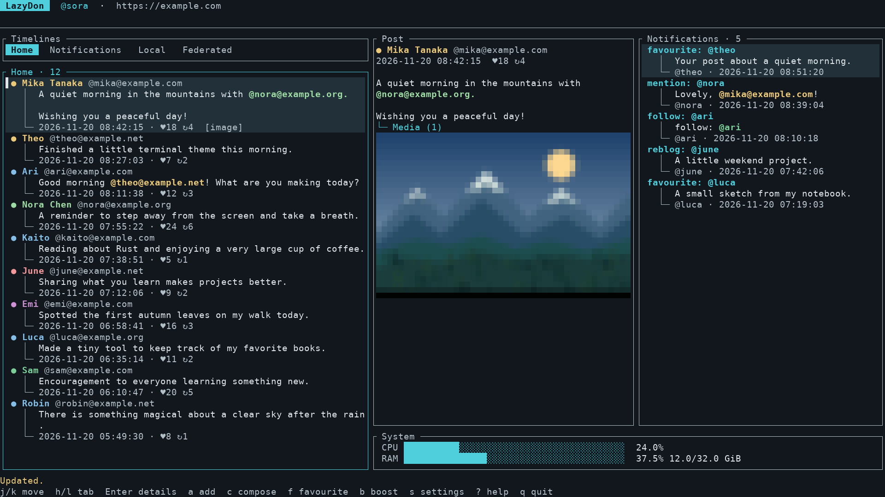

# LazyDon

Vim 風のキー操作で使える Mastodon ターミナルクライアントです。ホームと通知を同時に表示でき、ローカル／連合タイムラインのタブ追加、ユーザーごとの色分け表示、CPU・RAM モニターに対応しています。



## 動作環境

- **OS:** Linux x86_64（GitHub Release 配布版）
- **アカウント:** HTTPS 接続および OOB 認証（コード貼り付け）に対応した Mastodon サーバー
- **画像表示:** Kitty / iTerm2 / Sixel を自動検出（非対応端末・tmux・screen では半角ブロック表示。`LAZYDON_IMAGE_PROTOCOL` で `kitty` / `iterm2` / `sixel` / `halfblocks` を指定可能）
- **外部アプリ起動:** `xdg-open`（認証ページ・元画像・動画・リンクを開く場合）
- **画像貼り付け（任意）:** `wl-paste`（Wayland）または `xclip`（X11）

## インストールと起動

`curl`、`tar`、`sha256sum` などを使用し、チェックサムを検証して `~/.local/bin/lazydon` にインストールします（保存先は `LAZYDON_INSTALL_DIR` で変更可能）。

```sh
curl -fsSLo install-lazydon.sh https://raw.githubusercontent.com/hama6767/LazyDon/main/install.sh
sh install-lazydon.sh
export PATH="$HOME/.local/bin:$PATH"
lazydon
```

永続的にパスを通す場合は、`~/.profile` などに `export PATH="$HOME/.local/bin:$PATH"` を追記してください。

### 手動インストール

[Releases](https://github.com/hama6767/LazyDon/releases) から `lazydon-linux-x86_64.tar.gz` と `.sha256` を同じディレクトリにダウンロードして実行します。

```sh
sha256sum -c lazydon-linux-x86_64.tar.gz.sha256
tar -xzf lazydon-linux-x86_64.tar.gz
./lazydon
```

## ログインとアカウント管理

初回起動時にサーバー名を入力し、自動で開く認証ページで取得したコードを貼り付けます。ブラウザーが開かない場合は `:open` で開き直すか、`:copy` で URL をコピーできます。`:show` で完全な URL の表示もできますが、画面上では折り返される場合があります。

複数アカウントは `s` → `Accounts` から管理できます。追加時は認証ページが自動で開き、`Ctrl-O` で開き直すか、`Ctrl-Y` で URL をコピーできます。URL のコピーには `wl-copy` または `xclip` が必要です。

- `a`: アカウントを追加
- `j` / `k` → `Enter`: アカウントを切り替え
- `d` → `y`: アカウントを削除

以前のバージョンで認証したアカウントでフォローするには、同じアカウントを追加して再認証してください。認証情報は `$XDG_CONFIG_HOME/lazydon/accounts.json`（既定: `~/.config/lazydon/accounts.json`）に保存されます。削除はローカルの認証情報に対して行われ、サーバー側の認可は残ります。

## キー操作

### 基本操作

| キー | 操作 |
| --- | --- |
| `[` / `]`、`gT` / `gt` | 前 / 次のアカウントへ切り替え |
| `j` / `k`、上下キー | 投稿を選択 |
| `g` / `G` | 先頭 / 末尾へ移動 |
| `h` / `l`、左右キー | タイムラインと通知を切り替え |
| `a` → `l` / `f` | ローカル / 連合タブを追加（既存なら移動） |
| `r` | 現在のタブを再取得 |
| `f` / `b` | お気に入り / ブースト |
| `Enter` | 投稿の詳細を開く |
| `c` | 投稿画面を開く |
| `s` | 設定を開く |
| `?` | ヘルプ |
| `q` | 終了 |

### 投稿画面

| キー | 操作 |
| --- | --- |
| `Ctrl-V` | クリップボードの PNG 画像を添付（最大 4 枚） |
| `Ctrl-S` | 送信 |
| `Esc` | 下書きを保持して閉じる |

Fcitx 5 / Fcitx では、画面を閉じたときや投稿に成功したときに英数入力への切り替えを試みます（`fcitx5-remote` / `fcitx-remote`、Fcitx 5 では `dbus-send` が必要）。IBus や SSH 接続先から操作できない IME では、通常の入力切り替えキーを使ってください。

### 詳細画面

| キー | 操作 |
| --- | --- |
| `j` / `k` | 投稿者・返信先・画像・動画・URL を選択 |
| `f` | 選択した投稿者または返信先をフォロー（鍵付きの場合は申請） |
| `Enter` | 選択したアカウントのプロフィールを表示、または画像・動画・URL を外部アプリで開く |
| `o` | 選択した画像・動画・URL を外部アプリで開く |
| `↑` / `↓`、`PageUp` / `PageDown` | スクロール |
| `Esc` | 閉じる |

プロフィール画面では `j` / `k` または上下キーでスクロールし、`n` で過去の投稿を追加取得できます。`Esc` で投稿詳細に戻ります。

## 設定とフォント

`s` で設定画面を開き、`j` / `k` で項目、`h` / `l` で値を変更できます。設定は `$XDG_CONFIG_HOME/lazydon/settings.json`（既定: `~/.config/lazydon/settings.json`）に保存されます。

- **テーマ:** Dark / Light / High contrast
- **表示密度:** Compact（既定） / Comfortable
- **フォント:** **Noto Sans Mono CJK JP** など Unicode 罫線・Truecolor 対応の端末／フォントを推奨します。Kitty（remote control 有効時）では設定画面の `Font size`（8〜24 pt、`0` で既定値）を `Enter` で適用できます。

## 開発

ビルドやテストの方法は [開発ガイド](https://github.com/hama6767/LazyDon/blob/main/doc/development.md) を参照してください。
