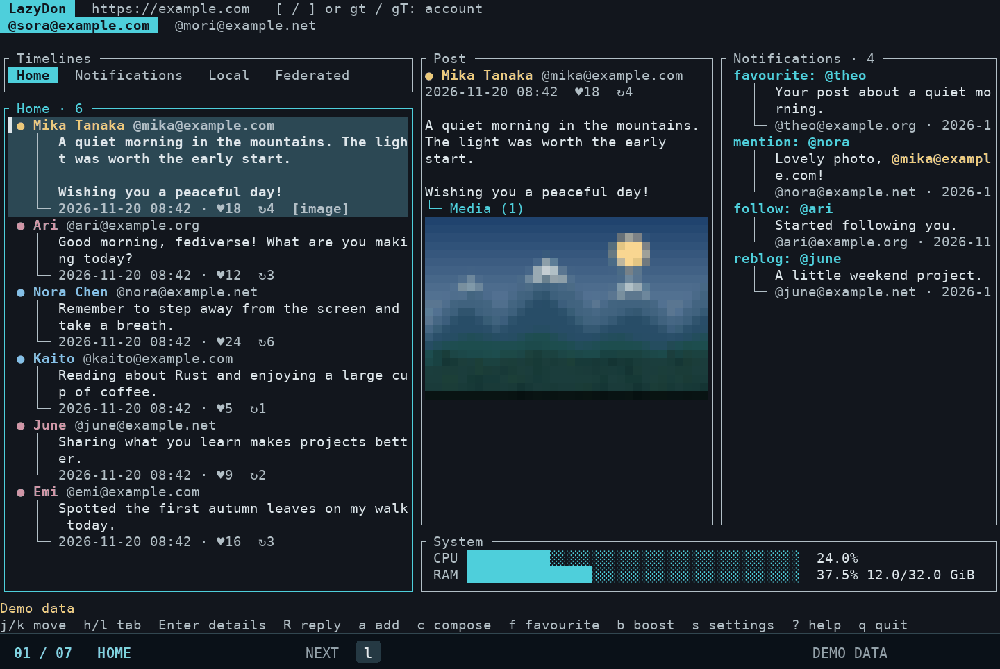

# LazyDon

English | [日本語](README.ja.md)

LazyDon is a Mastodon terminal client with Vim-style keybindings. View your home timeline and notifications side by side, add local and federated timeline tabs, identify users by color, and monitor CPU and RAM usage on Linux.



[Still preview](https://raw.githubusercontent.com/hama6767/LazyDon/main/docs/preview.png)

## Requirements

- **OS:** Linux x86_64 or ARM64, or macOS on Apple Silicon (GitHub Release builds)
- **Account:** A Mastodon server that supports HTTPS and out-of-band (OOB) authorization using a pasted code
- **Image display:** Kitty, iTerm2, and Sixel are detected automatically. Unsupported terminals, tmux, and screen use half-block rendering. Set `LAZYDON_IMAGE_PROTOCOL` to `kitty`, `iterm2`, `sixel`, or `halfblocks` to choose a protocol.
- **Opening external applications:** `xdg-open` on Linux or `open` on macOS (for authorization pages, original images, videos, and links)
- **Pasting images (optional):** `wl-paste` (Wayland) or `xclip` (X11). Clipboard image attachments are not yet available on macOS.
- **System monitor:** CPU and RAM usage require Linux; on macOS these values are shown as unavailable.

## Installation and launch

The installer selects the appropriate release for your platform, verifies its checksum with `sha256sum` or `shasum`, and installs LazyDon to `~/.local/bin/lazydon`. Set `LAZYDON_INSTALL_DIR` to choose another destination.

```sh
curl -fsSLo install-lazydon.sh https://raw.githubusercontent.com/hama6767/LazyDon/main/install.sh
sh install-lazydon.sh
export PATH="$HOME/.local/bin:$PATH"
lazydon
```

To add the directory to your PATH permanently, add `export PATH="$HOME/.local/bin:$PATH"` to `~/.profile` or a similar shell configuration file.

### Manual installation

Download the archive and its `.sha256` file for your platform from [Releases](https://github.com/hama6767/LazyDon/releases): `lazydon-linux-x86_64.tar.gz`, `lazydon-linux-aarch64.tar.gz`, or `lazydon-macos-aarch64.tar.gz`. For example, on Apple Silicon macOS:

```sh
shasum -a 256 -c lazydon-macos-aarch64.tar.gz.sha256
tar -xzf lazydon-macos-aarch64.tar.gz
./lazydon
```

## Login and account management

On first launch, enter your server name and paste the code from the authorization page that opens automatically. If your browser does not open, use `:open` to try again or `:copy` to copy the URL. You can also use `:show` to display the complete URL, although it may wrap on screen.

Manage multiple accounts under `s` → `Accounts`. When adding an account, the authorization page opens automatically; use `Ctrl-O` to reopen it or `Ctrl-Y` to copy the URL. Copying a URL requires `wl-copy` or `xclip` on Linux, or `pbcopy` on macOS.

- `a`: Add an account
- `j` / `k` → `Enter`: Switch accounts
- `d` → `y`: Remove an account

To follow users with an account authorized in an earlier version, add the same account and authorize it again. Credentials are stored in `$XDG_CONFIG_HOME/lazydon/accounts.json` (default: `~/.config/lazydon/accounts.json`). Removing an account deletes its local credentials; the server-side authorization remains.

## Keybindings

### General

| Key | Action |
| --- | --- |
| `[` / `]`, `gT` / `gt` | Switch to the previous / next account |
| `j` / `k`, Up / Down | Select a post |
| `g` / `G` | Move to the beginning / end |
| `h` / `l`, Left / Right | Switch the focused timeline or panel |
| `a` → `l` / `f` | Add a local / federated tab, or switch to it if already open |
| `r` | Refresh the current tab |
| `R` | Reply to the selected post |
| `f` / `b` | Favorite / boost |
| `Enter` | Open post details |
| `c` | Open the composer |
| `s` | Open settings |
| `?` | Show help |
| `q` | Quit |

### Composer

| Key | Action |
| --- | --- |
| `Ctrl-V` | Attach a PNG image from the clipboard on Linux (up to 4 images) |
| `Ctrl-S` | Send |
| `Esc` | Close and keep the draft |
| `Ctrl-D` twice | Discard the draft and attachments |

With Fcitx 5 or Fcitx, LazyDon attempts to switch to alphanumeric input when the composer closes or a post is sent successfully. This requires `fcitx5-remote` or `fcitx-remote`, and `dbus-send` for Fcitx 5. For IBus or an IME that cannot be controlled from an SSH session, use your usual input-switching key.

For replies, LazyDon fills in the recipients and chooses the more restrictive visibility of the original post and the account's default. If it cannot retrieve the default, it uses `direct`. You can check the recipients and visibility before sending.

### Post details

| Key | Action |
| --- | --- |
| `j` / `k` | Select the author, reply recipient, an image, a video, or a URL |
| `f` | Follow the selected author or reply recipient (sends a request for a locked account) |
| `R` | Reply to the post |
| `t` | Open the reply tree |
| `r` | Refresh the reply tree |
| `c` | Resume the saved draft |
| `Enter` | Open the selected account's profile, or open an image, video, or URL in an external application |
| `o` | Open the selected image, video, or URL in an external application |
| `↑` / `↓`, `PageUp` / `PageDown` | Scroll |
| `Esc` | Close |

On a profile, use `j` / `k` to select a post, `Enter` to open its details, and `R` to reply. Use the Up / Down arrows or `PageUp` / `PageDown` to scroll through profile information, and `n` to load older posts. Press `Esc` to return to the previous screen. In the reply tree, use `j` / `k` to select a post, then `Enter` to open its details or `R` to reply. Press `c` in either screen to resume a saved draft. The tree displays up to 500 posts.

## Settings and fonts

Press `s` to open settings, `j` / `k` to select an item, and `h` / `l` to change its value. Settings are saved in `$XDG_CONFIG_HOME/lazydon/settings.json` (default: `~/.config/lazydon/settings.json`).

- **Theme:** Dark / Light / High contrast
- **Display density:** Compact (default) / Comfortable
- **Layout:** Default shows notifications and direct messages on the right. Your timeline focus retains the original timeline and notifications layout. Federation shows the federated timeline above notifications.
- **Direct messages:** The Default layout shows the latest message in each conversation. Opening a conversation does not mark it as read on the server.
- **Font:** A terminal and font with Unicode box-drawing and Truecolor support, such as **Noto Sans Mono CJK JP**, are recommended. In Kitty with remote control enabled, apply the `Font size` setting (8–24 pt, or `0` for the default) by pressing `Enter`.

## Development

See the [development guide](https://github.com/hama6767/LazyDon/blob/main/docs/development.md) for build and test instructions.
